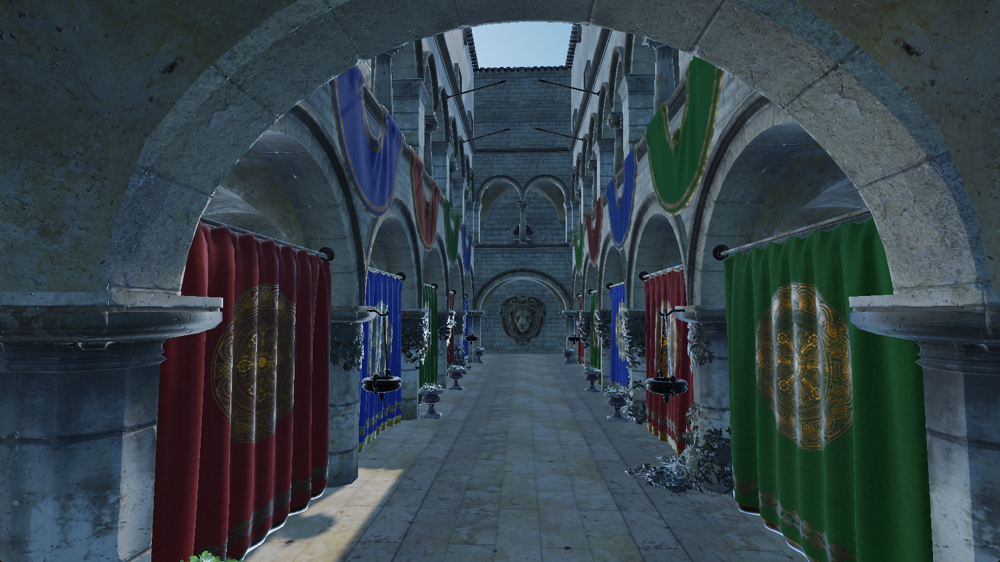
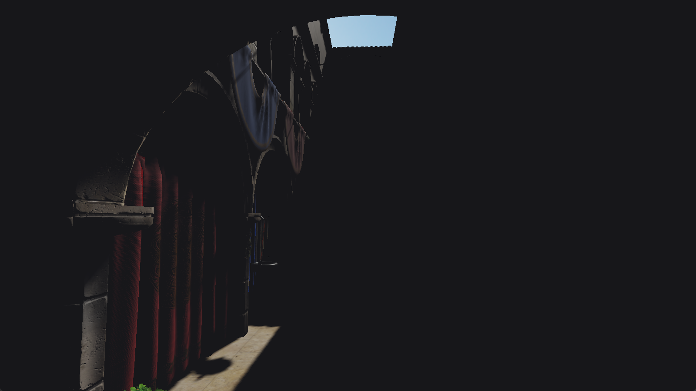
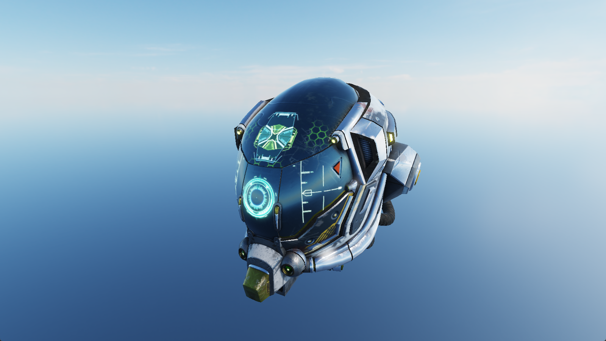
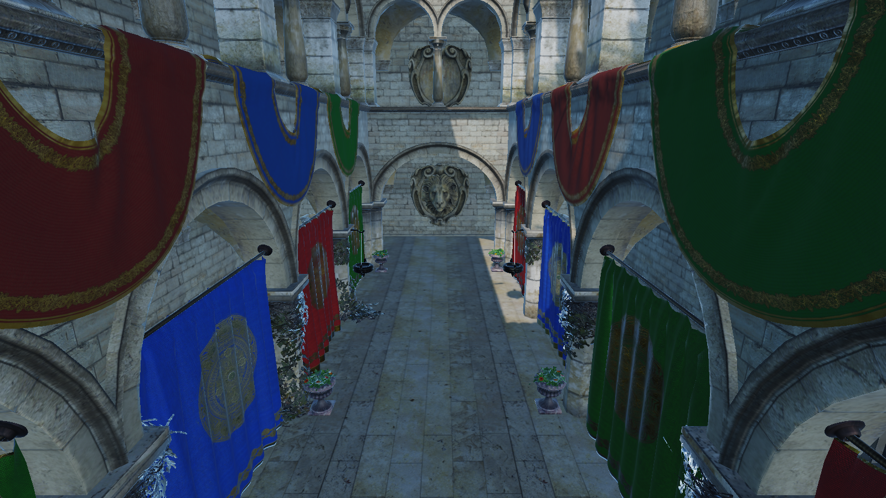

# RenderEngine — DirectX 12 PBR レンダラ

DirectX 12 をゼロから書いた、物理ベースレンダリング(PBR)と
イメージベースドライティング(IBL)によるリアルタイムレンダラです。
外部のレンダリングライブラリやヘルパ(DirectX-Headers の `d3dx12.h`、
DirectXTK、Assimp など)は使わず、glTF ローダーと JSON パーサも自作しています。



---

## 主な実装

### PBR

- **Cook-Torrance BRDF** — GGX / Trowbridge-Reitz 法線分布、Smith 幾何減衰、Schlick フレネル
- metallic / roughness ワークフロー(glTF 2.0 準拠)
- エネルギー保存(`kD = (1 - F)(1 - metallic)`)

### イメージベースドライティング

UE4 の **split-sum 近似**にもとづく実装。起動時に HDRI から 3 種類のマップを生成します。

| 事前計算 | 内容 |
|---|---|
| **irradiance map** | 半球を余弦重み付きで積分した拡散用マップ(64×32) |
| **prefiltered environment map** | roughness 別にぼかした鏡面用マップ。ミップレベルを roughness に対応させる(256×128、6 mip) |
| **BRDF LUT** | `N·V` と roughness の 2 次元テーブル。GGX 重要度サンプリングで積分(256×256、R16G16_FLOAT) |

環境マップは等距円筒図法のまま扱い、方向ベクトルとの相互変換で参照しています。

| IBL あり | IBL なし(直接光のみ) |
|---|---|
|  |  |

環境光を切ると、日の当たる床以外がほぼ黒く落ちます。屋内シーンの見えの大半を
IBL が担っていることが分かります。

### マテリアル

glTF 2.0 の 5 種類のテクスチャに対応しています。

- ベースカラー(sRGB)
- メタリック・ラフネス(G = roughness, B = metallic)
- 接空間ノーマルマップ(TBN 行列で変換)
- アンビエントオクルージョン(環境光にのみ適用)
- エミッシブ

アルファモード `MASK` は `clip()` によるアルファテスト、`doubleSided` は
カリングを切った PSO への切り替えで対応しています。



### シャドウ

- 平行光源のシャドウマップ(2048²、直交投影)
- 比較サンプラ(`SamplerComparisonState`)による 3×3 PCF
- 深度バイアス + 傾斜スケールバイアスでシャドウアクネを抑制
- 深度パスでもアルファテストを行い、葉の抜けた形の影を落とす
- `R32_TYPELESS` で作成し、DSV は `D32_FLOAT`、SRV は `R32_FLOAT` として解釈

### HDR パイプラインとポストプロセス

```
シーン描画 → HDR バッファ(R16G16B16A16_FLOAT)
           → ブルーム(輝度抽出 → 分離ガウシアン ×2 往復、1/4 解像度)
           → トーンマップ(露出 → ACES → sRGB)→ バックバッファ
```

ブルームのぼかしは、バイリニア補間を利用して 9 タップを 5 サンプルで実現しています。



### アセット読み込み(自作)

- **glTF 2.0** — `.gltf` / `.glb`、外部バッファ・`data:` URI・埋め込みバッファビューに対応
  - 右手座標系 → 左手座標系の変換(Z 反転 + ワインディング反転)
  - シーングラフのノード変換を頂点に焼き込み
  - `TANGENT` が無い場合は UV から自動生成
- **JSON パーサ** — glTF を読むために自作(`src/Json.h`)
- **Radiance HDR (.hdr)** — RGBE の RLE デコード
- **PNG / JPEG** — WIC(Windows Imaging Component)経由。外部ライブラリ不要
- **ミップマップ** — CPU で生成。sRGB テクスチャはリニア空間で平均してから戻す

---

## DirectX 12 まわりの設計

### ディスクリプタヒープのレイアウト

シェーダから見える CBV/SRV/UAV ヒープは 1 つしかバインドできないため、
全リソースを 1 本のヒープに並べ、オフセットで参照しています。
**可変長のマテリアルを末尾に置く**ことで、マテリアル数が変わっても
固定リソースの位置がずれない構成にしています(`Renderer.h` の `kSrv*` 定数)。

```
[0..3]  IBL(環境マップ / irradiance / prefilter / BRDF LUT)
[4]     シャドウマップ
[5]     HDR バッファ
[6..7]  ブルーム作業用
[8..12] 既定マテリアル(テクスチャを持たないオブジェクト用)
[13..]  glTF のマテリアル(5 枚 × マテリアル数)
```

### ルートシグネチャ

更新頻度で分けています。

| 番号 | 内容 | 更新頻度 |
|---|---|---|
| 0 | 定数バッファ(ルート CBV) | 描画ごと |
| 1 | IBL テクスチャ(テーブル) | フレームごと |
| 2 | マテリアルテクスチャ(テーブル) | 描画ごと |
| 3 | シャドウマップ(テーブル) | フレームごと |

オブジェクトごとの定数は 1 本のバッファに 256 バイト境界で並べ、
ルート CBV に渡す GPU アドレスをオフセットするだけで切り替えています。

### その他

- テクスチャは UPLOAD ヒープを経由して DEFAULT ヒープへコピー
  (`GetCopyableFootprints` で行ピッチのアラインメントを解決)
- シェーダは実行時コンパイル(`D3DCompileFromFile`)。共通定義は
  `shaders/Common.hlsli` に集約
- Debug ビルドではデバッグレイヤーを有効化し、エラー発生時にブレーク

---

## ビルド

| 項目 | 内容 |
|---|---|
| 環境 | Visual Studio 2026(PlatformToolset v145) |
| 言語 | C++20 |
| SDK | Windows SDK 10 |
| 構成 | x64 / Debug・Release |

`RenderEngine.slnx` を開いてビルドしてください。
外部ライブラリの取得は不要です(WIC・D3D12・DXGI は Windows SDK に含まれます)。

---

## アセットの準備

**アセットはライセンスの都合でリポジトリに含めていません。**
以下を取得して `assets/` に配置してください。

| ファイル | 入手先 | ライセンス |
|---|---|---|
| `assets/env.hdr` | [Poly Haven](https://polyhaven.com/hdris) の任意の HDRI(2K 推奨) | CC0 |
| `assets/model.glb` | 表示したい glTF モデル | モデルによる |

スクリーンショットに使用したモデル:

- **Sponza** — [KhronosGroup/glTF-Sample-Assets](https://github.com/KhronosGroup/glTF-Sample-Assets/tree/main/Models/Sponza)
  （Crytek / Cryengine Limited License Agreement。再配布不可のため同梱していません）
- **Damaged Helmet** — [KhronosGroup/glTF-Sample-Assets](https://github.com/KhronosGroup/glTF-Sample-Assets/tree/main/Models/DamagedHelmet)

Sponza は `.glb` 形式が配布されていないため、`.gltf` + `.bin` + テクスチャ一式を
取得したうえで、`Renderer::CreateVertexBuffer` の読み込みパスを変更してください。

---

## 動作の目安

Sponza(103 プリミティブ / 25 マテリアル / 65 テクスチャ / 262,267 三角形)で

- 起動時間: 約 3.4 秒(Release、テクスチャのデコード・ミップ生成・IBL 事前計算を含む)
- 解像度: 1600×900

起動時間の内訳を計測したうえで、sRGB 変換のテーブル化により
4.9 秒 → 3.4 秒へ短縮しています。

---

## 既知の制限・未実装

自覚している範囲を挙げておきます。

- **カスケードシャドウマップ未実装** — 単一のシャドウマップで広範囲を覆うため、
  大きなシーンでは影の解像度が不足する
- **半透明(alphaMode = BLEND)未対応** — 描画順のソートが必要
- **ウィンドウのリサイズ未対応** — バッファの再生成処理が未実装
- **頂点バッファが UPLOAD ヒープのまま** — 本来は DEFAULT ヒープへコピーすべき
- **ミップマップ生成が CPU・シングルスレッド** — 起動時間の最大要因。
  マルチスレッド化またはコンピュートシェーダ化の余地がある
- **ブルームのしきい値が露出の影響を受けない** — 厳密には輝度抽出の前に
  露出を適用すべき

---

## 参考文献

- Brian Karis, *Real Shading in Unreal Engine 4*, SIGGRAPH 2013 Course（split-sum 近似）
- Sébastien Lagarde, Charles de Rousiers, *Moving Frostbite to PBR*, SIGGRAPH 2014 Course
- Brian Karis, *Physically Based Shading on Mobile*（環境 BRDF の解析的近似）
- Tomas Akenine-Möller et al., *Real-Time Rendering, 4th Edition*
- Joey de Vries, *LearnOpenGL* — PBR / IBL の章
- Krzysztof Narkowicz, *ACES Filmic Tone Mapping Curve*
- Microsoft, *DirectX-Graphics-Samples* および Direct3D 12 プログラミングガイド

---

## ディレクトリ構成

```
src/
  main.cpp        Win32 ウィンドウとメインループ
  Manager.*      入力・シーン・描画の実行順序と寿命管理
  Scene_*.h/cpp  シーンごとの配置とカメラ制御
  ObjectManager.* GameObject の所有・更新・描画・当たり判定
  ComponentManager.* オブジェクトに付ける機能の所有・実行
  Input.* / Camera.* 入力取得と追従カメラの計算
  ModelManager.* モデルデータを正規化したパス単位で共有
  ModelComponent.* モデルの読み込みと個別ワールド行列による描画
  *Collider.* / CollisionManager.* 球・Y軸カプセル・AABB の接触判定
  Renderer.h/cpp  DX12 の初期化手順とリソース解放
  RendererDevice.cpp / RendererModels.cpp デバイスとモデルリソース
  RendererEnvironment.cpp IBL の事前計算
  RendererPipelines.cpp / RendererPostProcess.cpp 描画・後処理の準備
  RendererFrame.cpp フレーム描画と同期
  GltfLoader.*    glTF 2.0 の読み込み(WIC による画像デコードを含む)
  Json.*          JSON パーサ
  HdrLoader.*     Radiance HDR の読み込み
shaders/
  Common.hlsli    定数バッファ・共通関数
  Triangle.hlsl   PBR 本描画
  Skybox.hlsl     背景
  Irradiance.hlsl 拡散 IBL の事前計算
  Prefilter.hlsl  鏡面 IBL の事前計算
  BrdfLut.hlsl    BRDF LUT の生成
  ShadowDepth.hlsl シャドウマップ生成
  Tonemap.hlsl    トーンマップ
  BloomBright.hlsl / BloomBlur.hlsl  ブルーム
docs/screenshots/ スクリーンショット
tests/           コンポーネント・衝突・カメラ・モデル共有の回帰テスト
```

## ゲーム側の追加方法

`Scene_Game::Initialize()` で `AddGameObject<T>(...)` を呼ぶと、初期化・更新・描画と寿命管理をまとめて登録します。
`GameObject` 派生クラスには `AddComponent<T>(...)` で機能を追加できます。
モデル表示は `ModelComponent`、当たり判定は `SphereCollider` / `CapsuleCollider` / `BoxCollider` が担当します。
オブジェクト・コンポーネントは所有側の破棄時に自動解放され、取得したポインタは所有側より長く保持できません。

更新順は入力取得 → シーンの `OnUpdate` → 全オブジェクト → 全コンポーネント → 接触判定 → `OnAfterUpdate` → 描画です。
接触結果を当フレーム中に使う場合は `OnAfterUpdate` で参照します。更新中に追加したオブジェクトの更新は次フレームからです。
カメラはプレイヤーの移動後に追従し、定数バッファはバックバッファごとに書き込み領域を分けています。

現時点の制約: GPU に登録できるモデルは1種類（複数配置は可能）。FBX は未対応です。
箱は軸平行、カプセルはY軸固定で、コライダー寸法はワールド単位（オブジェクトの回転・拡縮とは独立）です。
当たり判定は接触検出のみで、押し戻し・ダメージ処理は含みません。

## 回帰テスト

Visual Studio の C++ 開発ツール導入後、プロジェクト直下で実行します。描画ウィンドウや外部モデルは不要です。

```powershell
powershell -ExecutionPolicy Bypass -File tests/RunTests.ps1
```

コンポーネントの寿命・有効無効・描画呼び出し、更新中の追加、球・カプセル・箱の全組合せ、カメラの距離・角度制限、モデルキャッシュのパス共有を確認します。
